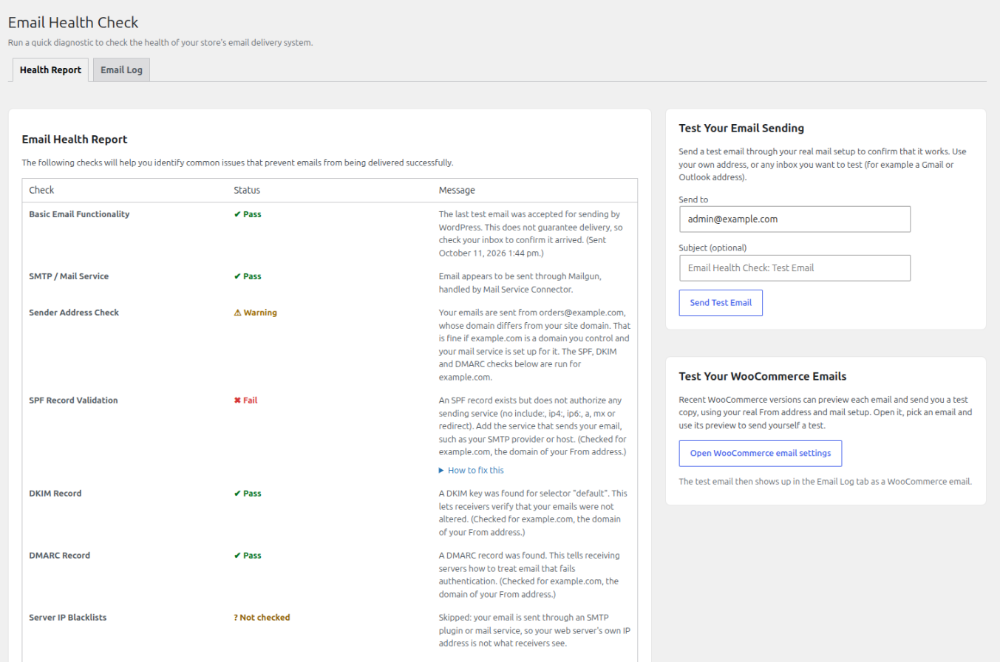
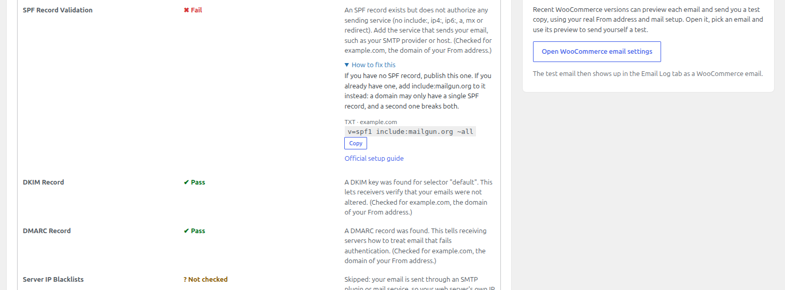
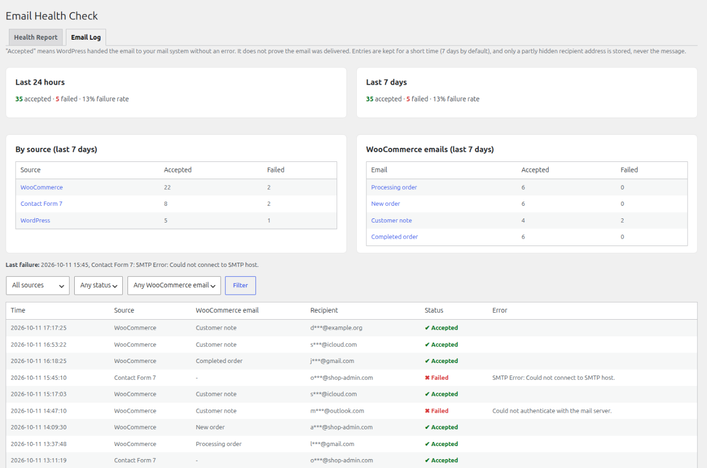
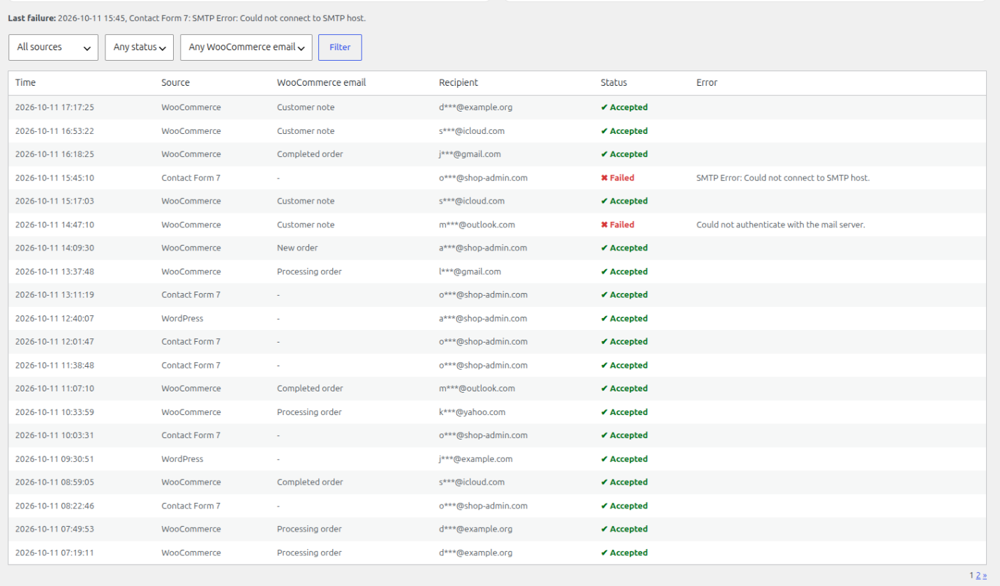
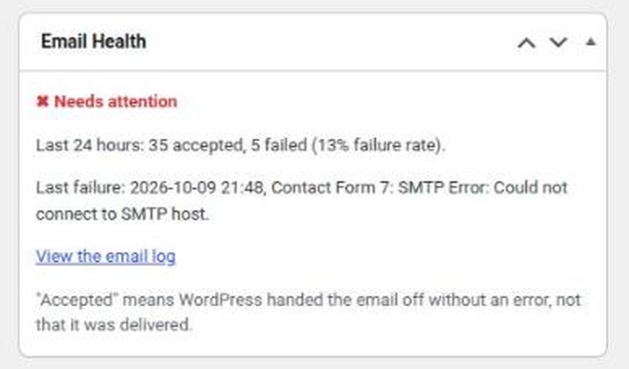
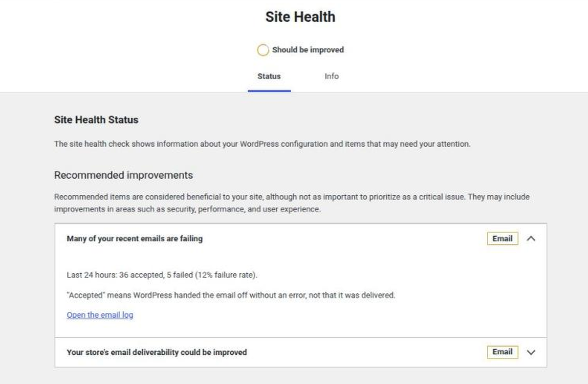

# Email Health Check & Log for WooCommerce – SPF, DKIM, DMARC & Alerts

[](https://wordpress.org/plugins/ecom-email-health-check/)
[](LICENSE)

Email log, SPF/DKIM/DMARC checks and failure alerts. Find out why WooCommerce order emails go to spam or never arrive.

> This is the development repository. The released plugin lives on [WordPress.org](https://wordpress.org/plugins/ecom-email-health-check/); its description and FAQ are in [`readme.txt`](readme.txt), which this page mirrors.

## The problem

WooCommerce emails not sending, or landing in spam? Many hosts have poor email setups that fail silently, so you and your customers never find out why an order confirmation did not arrive.

## What it does

Email Health Check looks at how your WordPress or WooCommerce site sends email and tells you what is wrong in plain language: SPF, DKIM and DMARC problems, mail sent through plain PHP mail, a blacklisted server IP, order emails that are switched off or stuck behind unpaid orders, and more. It also keeps an email log of what your site sends. It is free, needs no account, and sends no email content or personal data to any service. The only outside lookup is a server IP blacklist check that runs only when your site sends mail directly from your server (see "External services" in [`readme.txt`](readme.txt)).

### What it does not do

* It is **not an SMTP plugin** and does not send your email for you; it works next to whichever plugin or mail service you use.
* **No account, no upsell banners or nags, no tracking and no analytics.** It makes no HTTP requests of its own and sends nothing to the plugin's authors; the only outside lookups are the DNS queries described under External services. The only prompt it ever shows is one dismissible request for a review, on its own screens, to administrators only.
* **One plain text link, no more:** there is one small link, "Follow the Pro plan", to a waiting list page for a possible future Pro version (in the footer of its own screen and on its row in the Plugins list). The plugin never requests anything for it and sends nothing; it can be hidden with the `ecehc_show_pro_link` filter. Nothing in this free plugin is removed or locked.
* **Nothing bundled:** no third-party libraries, fonts or scripts, only the plugin's own code.

### What data it touches

* **The checks** read your site's own settings and look up the public DNS records of your sending domain through your server's own DNS resolver. The one lookup that involves your server is the IP blacklist check, which runs only when your site sends mail directly from your server (see "External services" in [`readme.txt`](readme.txt)).
* **The email log** keeps the time, source, status, WooCommerce email type, the order number for WooCommerce order emails, the recipient's domain, a partly hidden address such as j***@example.com and an error message with addresses hidden. Never the subject or the message. Kept 7 days by default (1, 3 or 7), can be turned off or cleared, and removed on uninstall.
* **A test email** goes only to the address you type (or the site admin address if you leave it blank).
* Nothing is sent to the plugin's authors.

### Diagnose

* **Email Health Report:** one page with a Pass, Warning or Fail status for each check. The page opens at once and the checks (including the DNS lookups) run in the background.
* **"Fix this first" summary** at the top of the report: the one check to fix first (failures before warnings, never a "Not checked" result) with a plain-language next step and a link to its "How to fix this" panel.
* **Getting-started checklist** for new installs, and **Copy support report** (versions, domains, check results; no passwords, message contents or full email addresses).
* **Sending test** to your own address or any inbox you want to try, with an optional subject.
* **SMTP / mail service:** warns when mail goes out through plain PHP mail, and names the plugin that handles your outgoing email.
* **Sender address, SPF, DKIM and DMARC**, checked for the domain you actually send from.
* **Server IP blacklists** (DroneBL and PSBL) when you send straight from your server.
* **"WooCommerce emails not arriving?" panel** (WooCommerce only): combines the results and the last 7 days of the Email Log into the most likely cause and one next step. It makes no requests of its own and stores nothing.
* **WooCommerce email setup** (turned-off emails, recipient, From address, outdated theme overrides) and **unpaid orders** (WooCommerce sends no order email for "Pending payment" or "Failed" orders).

### Email log and failure alerts

* **Email Log and statistics:** every email your site sends, with source, WooCommerce email type, status and error; filters; accepted and failed counts for 24 hours and 7 days. Only a partly hidden recipient address is stored, never the message. Retention, switching off and clearing are in the Email Log tab.
* **Emails for this order** (WooCommerce): a read-only panel on the order screen (classic and High-Performance Order Storage) that lists the emails logged for that order, newest first, with time, email type, partly hidden recipient, status and error. Shown only to administrators while the email log is on. Only emails sent after the panel was added are listed, and only for as long as the log keeps them. It makes no requests and stores only the order number in the existing log.
* **Failure alerts in wp-admin:** an "Email Health" dashboard widget and a Site Health test, with no email needed.

### Fix

* **"How to fix this" panels:** a copy-paste DNS record where the provider documents one, and a link to the provider's official guide (SendGrid, Mailgun, Brevo, Postmark, Amazon SES, SparkPost, Mailjet, Elastic Email, Google Workspace, Microsoft 365).

### For developers

The `ecehc_checks_completed` action fires after every run of the checks, with the results of each check. With the `ecehc_email_logged` action and the filters, the supported hooks, the `ecehc_run_checks()` function and a stability promise are in [`docs/extending.md`](docs/extending.md).

### WP-CLI

```
wp ehc check            # runs all checks, exit status 1 if one fails (--format=json for scripts)
wp ehc log              # recent logged emails (--source --status --type --limit)
wp ehc log --stats      # accepted and failed counts for 24 hours and 7 days
```

## Screenshots

| | |
|---|---|
|  |  |
|  |  |
|  |  |

## FAQ

The full FAQ is in [`readme.txt`](readme.txt). Four answers that matter for trust:

**Does the email log slow down my site?** Each email causes one small database insert. Entries older than the retention period (7 days by default) are deleted by a daily cleanup, which also trims the log to the newest 5,000 entries (change with the `ecehc_log_max_rows` filter). Between cleanups the log can briefly be larger. The Health Report opens at once and runs its checks, including the DNS lookups, in the background on the plugin's own screen. The same checks also run when you open Tools > Site Health or use WP-CLI.

**Can the email log stop or change my emails?** Logging only observes. The hooks it uses (the `wp_mail` filter, `pre_wp_mail`, and WooCommerce's mail callback filter) hand back exactly what they receive, so this plugin does not change the subject, recipients, headers or attachments. Each email causes one small database insert, with no extra web request. If writing the log entry fails, the error is swallowed and the email is sent anyway. Mail that another plugin sends through the `pre_wp_mail` short circuit never reaches the log, so it is not logged. These points are covered by the dependency-free tests in `tests/MailSafetyTest.php`.

**What is removed when I uninstall the plugin?** Deleting the plugin removes everything it stored: the email log table (`{prefix}ecehc_email_log`), its settings and schema version, the last test email result, the install date, the getting-started checklist flag, the cached lookups (SMTP detection, server IP blacklist, plugin names, log statistics), the daily log cleanup event, and the per-user records of the review request and the checklist. On multisite all of this is removed for every site (the per-user records are network-wide). The only other leftovers are the short-lived test email limits (a transient that expires on its own within 5 minutes). Deactivating removes nothing.

**Does the plugin show ads, upsells or notices?** No ads, no upsell banners and no tracking. Exactly two things: one plain text link, "Follow the Pro plan" (footer of its own screen and its Plugins-list row; hide it with the `ecehc_show_pro_link` filter), and one dismissible review request, only for administrators and only on its own screens ("Maybe later" hides it for 30 days, at most twice).

## Installation

Search for "Email Health Check" under `Plugins > Add New` and click Install and Activate, or download it from the [WordPress.org plugin page](https://wordpress.org/plugins/ecom-email-health-check/) and upload the `ecom-email-health-check` folder to `/wp-content/plugins/`. After activation the plugin opens its own top-level **Email Health Check** menu.

## Development

* PHP 7.4+ and WordPress 5.0+ (the email log needs WordPress 5.9+). No build step, no Composer or npm.
* Namespace `CodeSir\EmailHealthCheck`, PSR-4 autoloaded from `includes/`. Layout and conventions: [`CLAUDE.md`](CLAUDE.md).
* Hooks for add-ons and other developers (a stability promise, the `ecehc_checks_completed` action after every check run, filters, and the `ecehc_run_checks()` function): [`docs/extending.md`](docs/extending.md).
* Tests for the pure logic need nothing installed: `php tests/run.php` (add a test for every bug fix).
* Before a release run the official [Plugin Check](https://wordpress.org/plugins/plugin-check/) on a copy built with `.distignore`, and follow [`docs/compatibility.md`](docs/compatibility.md). The `Checks` workflow does lint, tests and Plugin Check on every pull request.
* Git flow: pull requests go to `develop`; a release is a `develop` to `trunk` pull request followed by a tag, which deploys to WordPress.org.
* Translations: `languages/ecom-email-health-check.pot`; community translations happen on [translate.wordpress.org](https://translate.wordpress.org/projects/wp-plugins/ecom-email-health-check/).

## Contributing

Bug reports, feature requests and pull requests are welcome: please open an issue on this repository first. Support questions are best asked in the [plugin's support forum](https://wordpress.org/support/plugin/ecom-email-health-check/).

## License

GPL v2.0 or later. See the [LICENSE](LICENSE) file.
